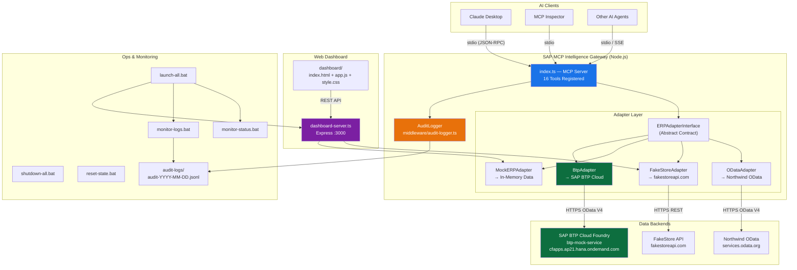
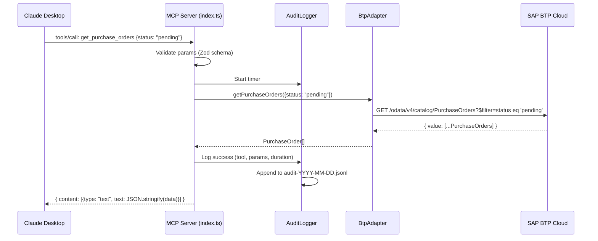
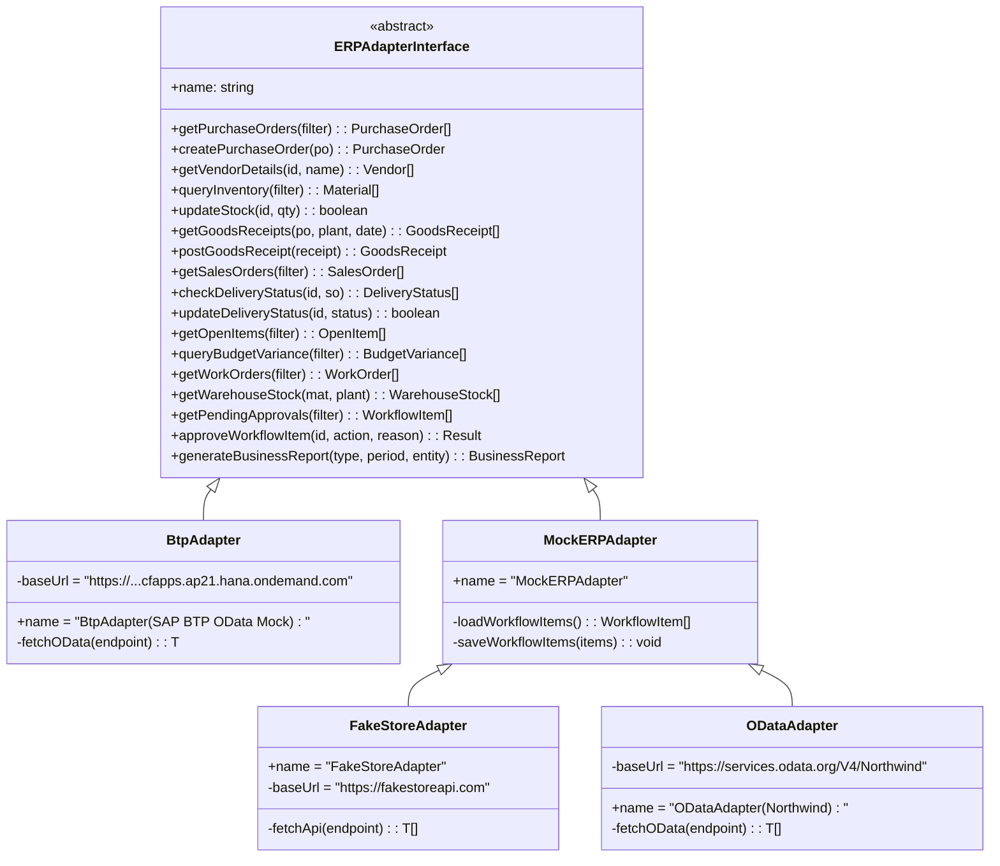
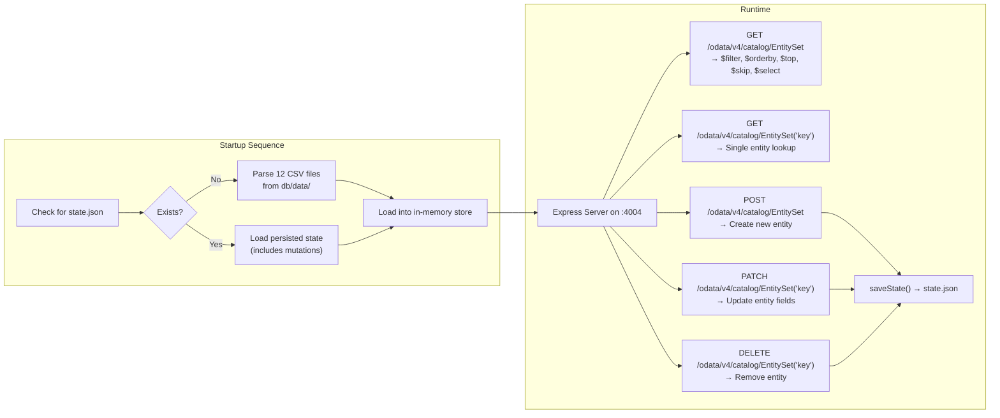
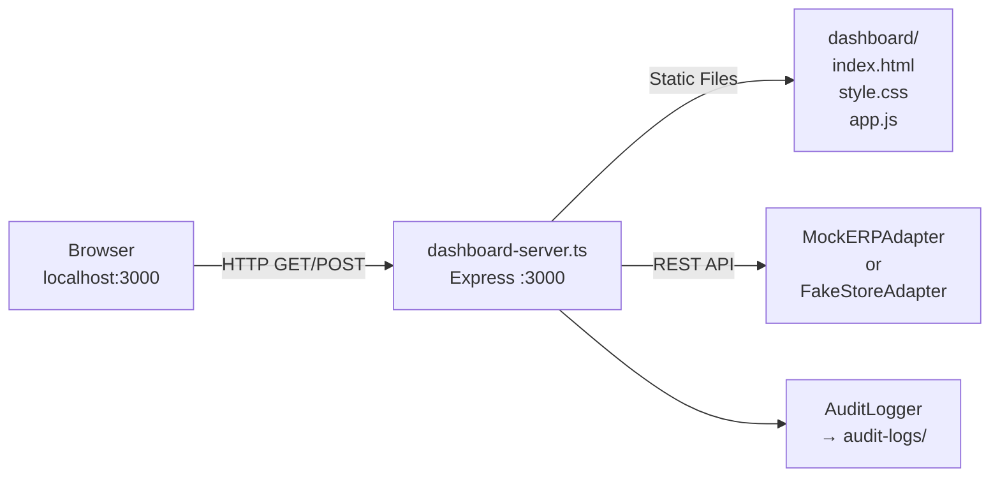
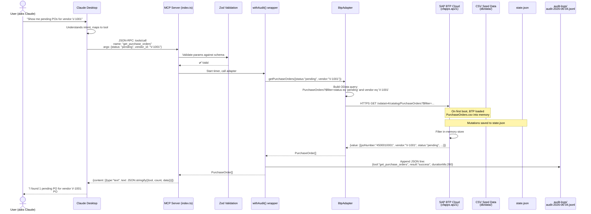
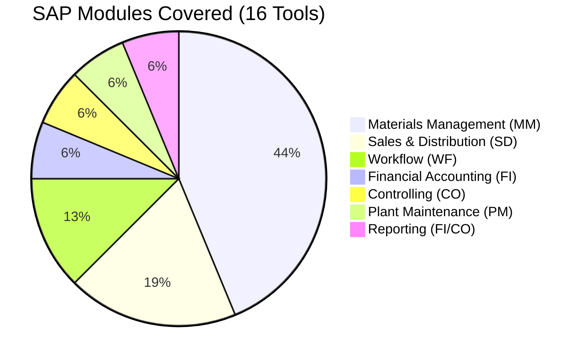
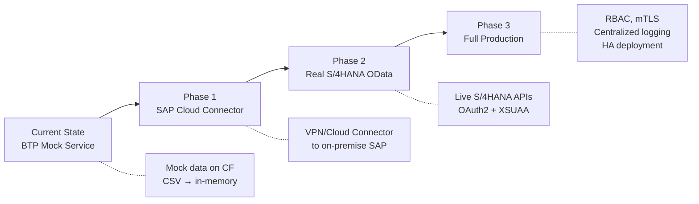

# SAP·MCP Intelligence Gateway — End-to-End Architecture

> **Project:** `sap-mcp-gateway` v1.0.0  
> **Author:** Shreyas  
> **License:** MIT  
> **Generated:** June 4, 2026

---

## 1. What Is This Project?

The **SAP·MCP Intelligence Gateway** is a bridge that allows **AI models** (like Claude, GPT, Gemini, etc.) to directly **read from and write to SAP ERP data** using the open **Model Context Protocol (MCP)** standard.

Instead of a human manually logging into SAP, navigating menus, and running transactions, an AI agent can now call structured "tools" — like `get_purchase_orders`, `query_inventory`, or `approve_workflow_item` — and the gateway translates those calls into real OData API requests against an SAP BTP backend.

```
┌──────────────┐     MCP (JSON-RPC)     ┌────────────────────┐     OData V4 / REST     ┌────────────────────┐
│   AI Model   │ ◄─────────────────────► │  SAP·MCP Gateway   │ ◄────────────────────► │  SAP BTP Backend   │
│ (Claude etc.) │     stdio / SSE        │  (Node.js Server)  │       HTTP/HTTPS        │  (Cloud Foundry)   │
└──────────────┘                         └────────────────────┘                         └────────────────────┘
```

---

## 2. High-Level Architecture Diagram



---

## 3. Complete Project File Map

```
D:\Projects\MCP System\
│
├── 📄 package.json                  # Root project config (sap-mcp-gateway)
├── 📄 tsconfig.json                 # TypeScript compiler config (ES2022, Node16)
├── 📄 Dockerfile                    # Docker image for dashboard (node:18-alpine)
├── 📄 claude_desktop_config.json    # Claude Desktop MCP server registration
├── 📄 index.html                    # (158KB) Standalone exported dashboard page
├── 📄 test-mcp.js                   # Quick JSON-RPC test script
│
├── 📂 src/                          # ── CORE SOURCE CODE ──
│   ├── 📄 index.ts                  # ★ MCP Server Entry Point (16 tools)
│   ├── 📄 dashboard-server.ts       # Express REST API for Web Dashboard
│   │
│   ├── 📂 adapters/                 # ── DATA ADAPTER LAYER ──
│   │   ├── 📄 erp-adapter.ts       # Abstract interface (contract for all adapters)
│   │   ├── 📄 btp-adapter.ts       # ★ PRODUCTION: Calls SAP BTP Cloud OData V4
│   │   ├── 📄 mock-adapter.ts      # DEV: In-memory hardcoded SAP data
│   │   ├── 📄 fakestore-adapter.ts  # DEV: Maps FakeStoreAPI → SAP types
│   │   └── 📄 odata-adapter.ts     # DEV: Maps Northwind OData → SAP types
│   │
│   ├── 📂 middleware/               # ── CROSS-CUTTING CONCERNS ──
│   │   └── 📄 audit-logger.ts      # Append-only JSONL audit trail
│   │
│   ├── 📂 mock-data/               # ── STATIC SEED DATA (for MockERPAdapter) ──
│   │   ├── 📄 mm-data.ts           # POs, Vendors, Materials, Goods Receipts
│   │   └── 📄 other-data.ts        # Sales, Deliveries, FI, CO, PM, WM, WF data
│   │
│   └── 📂 types/                   # ── TYPESCRIPT TYPE DEFINITIONS ──
│       └── 📄 sap.ts               # 15 interfaces + 7 filter types
│
├── 📂 btp-mock-service/             # ── SAP BTP CLOUD APPLICATION ──
│   ├── 📄 package.json             # Separate Node.js project
│   ├── 📄 manifest.yml             # Cloud Foundry deployment manifest
│   ├── 📄 tsconfig.json            # TypeScript config for BTP service
│   ├── 📂 src/
│   │   └── 📄 server.ts            # Express OData V4 server (371 lines)
│   └── 📂 db/
│       ├── 📄 state.json           # Persisted runtime state (mutations)
│       └── 📂 data/                # ── CSV SEED DATA (12 entity files) ──
│           ├── sap.mcp-PurchaseOrders.csv
│           ├── sap.mcp-Vendors.csv
│           ├── sap.mcp-Materials.csv
│           ├── sap.mcp-GoodsReceipts.csv
│           ├── sap.mcp-SalesOrders.csv
│           ├── sap.mcp-DeliveryStatuses.csv
│           ├── sap.mcp-OpenItems.csv
│           ├── sap.mcp-BudgetVariances.csv
│           ├── sap.mcp-BudgetLineItems.csv
│           ├── sap.mcp-WorkOrders.csv
│           ├── sap.mcp-WarehouseStocks.csv
│           └── sap.mcp-WorkflowItems.csv
│
├── 📂 dashboard/                    # ── WEB DASHBOARD FRONTEND ──
│   ├── 📄 index.html               # SPA shell with sidebar navigation
│   ├── 📄 style.css                # Full design system (9.4KB)
│   └── 📄 app.js                   # Client-side logic (17KB)
│
├── 📂 audit-logs/                   # ── RUNTIME AUDIT DATA ──
│   ├── 📄 audit-2026-06-03.jsonl   # Daily append-only tool call log
│   ├── 📄 audit-2026-06-04.jsonl   # Today's log
│   └── 📄 workflow-state.json      # Persisted workflow approval state
│
├── 📂 dist/                         # ── COMPILED JAVASCRIPT OUTPUT ──
│
├── 🔧 launch-all.bat               # Start all 4 services in separate windows
├── 🔧 start-mcp-server.bat         # Start MCP server only
├── 🔧 start-btp-mock.bat           # Start BTP mock service only
├── 🔧 start-dashboard.bat          # Start dashboard server only
├── 🔧 start-inspector.bat          # Launch MCP Inspector tool
├── 🔧 monitor-logs.bat             # Live tail of audit log (PowerShell)
├── 🔧 monitor-status.bat           # System health dashboard (10s refresh)
├── 🔧 shutdown-all.bat             # Kill all Node.js processes
└── 🔧 reset-state.bat              # Delete all persisted state + logs
```

---

## 4. Layer-by-Layer Deep Dive

### 4.1 — Layer 1: AI Clients (Consumers)

These are the applications that **connect to the MCP server** and invoke its tools.

| Client | Transport | Purpose |
|--------|-----------|---------|
| **Claude Desktop** | stdio (JSON-RPC over stdin/stdout) | Primary AI assistant — asks questions like "show me pending POs" and the MCP server returns structured SAP data |
| **MCP Inspector** | stdio | Interactive debugging tool — lets you manually call any of the 16 tools and inspect raw responses |
| **Other AI Agents** | stdio or SSE (HTTP) | Any MCP-compatible client can connect. SSE mode available via `npm run dev:sse` |

**How Claude Desktop discovers this server:**  
The file [claude_desktop_config.json](file:///d:/Projects/MCP%20System/claude_desktop_config.json) registers the server:
```json
{
  "mcpServers": {
    "sap-mcp-gateway": {
      "command": "node",
      "args": ["D:\\Projects\\MCP System\\dist\\index.js"]
    }
  }
}
```
Claude launches `node dist/index.js` as a child process and communicates over stdin/stdout using JSON-RPC.

---

### 4.2 — Layer 2: MCP Server Core ([index.ts](file:///d:/Projects/MCP%20System/src/index.ts))

This is the **heart of the system** — a Node.js process that:
1. Creates an `McpServer` instance using the `@modelcontextprotocol/sdk`
2. Registers **16 tools** with typed Zod schemas for input validation
3. Wraps every tool call with **audit logging** via the `withAudit()` helper
4. Delegates all data operations to the **active adapter** (currently `BtpAdapter`)



---

### 4.3 — Layer 3: The 16 MCP Tools

These are the **capabilities** exposed to AI. They are grouped by SAP module:

#### Materials Management (MM) — 6 Tools
| # | Tool | Type | Description |
|---|------|------|-------------|
| 1 | `get_purchase_orders` | 📖 Read | Query POs by status, vendor, material, plant, date |
| 2 | `query_inventory` | 📖 Read | Check stock levels, find shortages below reorder point |
| 3 | `get_vendor_details` | 📖 Read | Vendor master records with payment terms, ratings |
| 4 | `get_goods_receipts` | 📖 Read | Goods receipts posted against POs |
| 13 | `update_inventory_stock` | ✏️ **Mutation** | Directly update stock quantity for a material |
| 14 | `create_purchase_order` | ✏️ **Mutation** | Create a brand new PO in the system |
| 16 | `post_goods_receipt` | ✏️ **Mutation** | Post a goods receipt against an existing PO |

#### Sales & Distribution (SD) — 3 Tools
| # | Tool | Type | Description |
|---|------|------|-------------|
| 5 | `get_sales_orders` | 📖 Read | Sales orders with status, billing state |
| 6 | `check_delivery_status` | 📖 Read | Tracking/delivery status for shipments |
| 15 | `update_delivery_status` | ✏️ **Mutation** | Update delivery stage (pending → shipped → delivered) |

#### Financial Accounting (FI) — 1 Tool
| # | Tool | Type | Description |
|---|------|------|-------------|
| 7 | `get_open_items` | 📖 Read | AP/AR line items with aging analysis |

#### Controlling (CO) — 1 Tool
| # | Tool | Type | Description |
|---|------|------|-------------|
| 8 | `query_budget_variance` | 📖 Read | Budget vs. actual by cost center with line item drill-down |

#### Workflow (WF) — 2 Tools
| # | Tool | Type | Description |
|---|------|------|-------------|
| 9 | `get_pending_approvals` | 📖 Read | All pending workflow items sorted by urgency |
| 10 | `approve_workflow_item` | ✏️ **Mutation** | Approve or reject a workflow item (reason required for reject) |

#### Plant Maintenance (PM) — 1 Tool
| # | Tool | Type | Description |
|---|------|------|-------------|
| 12 | `get_work_orders` | 📖 Read | Maintenance work orders by equipment, status, priority |

#### Reporting (FI/CO) — 1 Tool
| # | Tool | Type | Description |
|---|------|------|-------------|
| 11 | `generate_business_report` | 📖 Read | Aggregated summaries: procurement spend, cost center P&L, open items |

> **Summary:** 10 read-only tools + **6 mutation tools** that can create/update real data.

---

### 4.4 — Layer 4: Adapter Pattern (Strategy Design Pattern)

This is the project's most important architectural decision. The MCP tools **never directly call any API**. Instead, they call methods on an abstract interface, and the concrete adapter handles the actual communication.



#### Adapter Details

| Adapter | Data Source | Use Case | Completeness |
|---------|-----------|----------|--------------|
| **BtpAdapter** ★ | SAP BTP Cloud Foundry (OData V4) | **Production** — used by the MCP server | Full (all 17 methods implemented) |
| **MockERPAdapter** | Hardcoded TypeScript arrays in `mock-data/` | Development & Dashboard REST API | Full |
| **FakeStoreAdapter** | `fakestoreapi.com` (public REST API) | Demo — maps products/users/carts to SAP types | Partial (vendors, inventory, sales only) |
| **ODataAdapter** | `services.odata.org` Northwind service | Demo — maps Northwind entities to SAP types | Partial (suppliers, products, orders only) |

> [!IMPORTANT]
> **To connect to a real SAP S/4HANA system**, you would create a new adapter (e.g., `S4HanaAdapter`) that implements the same `ERPAdapterInterface`, point it to your real OData endpoints, add OAuth2 authentication, and swap one line in `index.ts`:
> ```typescript
> // Change this:
> const adapter = new BtpAdapter();
> // To this:
> const adapter = new S4HanaAdapter();
> ```
> Zero changes needed in any of the 16 tool definitions.

---

### 4.5 — Layer 5: SAP BTP Mock Service ([btp-mock-service/](file:///d:/Projects/MCP%20System/btp-mock-service))

This is a **fully separate Node.js application** deployed on SAP BTP Cloud Foundry. It simulates a real SAP OData V4 backend.

#### How It Works



#### Key Features
- **12 Entity Sets:** PurchaseOrders, Vendors, Materials, GoodsReceipts, SalesOrders, DeliveryStatuses, OpenItems, BudgetVariances, BudgetLineItems, WorkOrders, WarehouseStocks, WorkflowItems
- **Full OData V4 query support:** `$filter` (eq, ne, gt, lt, ge, le), `$orderby`, `$top`, `$skip`, `$select`
- **CRUD operations:** GET, POST, PATCH, DELETE with proper OData response wrappers
- **Persistence:** All mutations (POST/PATCH/DELETE) are saved to `state.json` so data survives restarts
- **Admin reset:** `POST /admin/reset` reloads everything from the original CSV files
- **Health check:** `GET /health` returns service status, entity counts, and uptime

#### Cloud Foundry Deployment
The [manifest.yml](file:///d:/Projects/MCP%20System/btp-mock-service/manifest.yml) configures the deployment:
```yaml
applications:
  - name: btp-mock-service
    memory: 256M
    disk_quota: 512M
    random-route: true
    buildpacks:
      - nodejs_buildpack
    command: npm start
```

**Live URL:** `https://btp-mock-service-appreciative-meerkat-eb.cfapps.ap21.hana.ondemand.com`

---

### 4.6 — Layer 6: Type System ([src/types/sap.ts](file:///d:/Projects/MCP%20System/src/types/sap.ts))

Every piece of data flowing through the system is strictly typed. The type definitions model real SAP entity structures:

| Category | Interfaces | Description |
|----------|-----------|-------------|
| **MM** | `PurchaseOrder`, `Vendor`, `Material`, `GoodsReceipt` | Procurement & inventory entities |
| **SD** | `SalesOrder`, `DeliveryStatus` | Customer orders & shipping |
| **FI** | `OpenItem` | AP/AR line items with aging |
| **CO** | `CostCenter`, `BudgetVariance`, `BudgetLineItem` | Cost management |
| **PM** | `WorkOrder` | Plant maintenance |
| **WM** | `WarehouseStock` | Warehouse bin-level stock |
| **WF** | `WorkflowItem` | Approval workflows |
| **Reports** | `BusinessReport` | Aggregated business summaries |
| **Filters** | `POFilter`, `InventoryFilter`, `SOFilter`, `OpenItemFilter`, `BudgetFilter`, `WorkOrderFilter`, `WorkflowFilter` | Query parameter types |

> **Total:** 15 data interfaces + 7 filter interfaces = **22 type definitions**

---

### 4.7 — Layer 7: Audit & Compliance ([src/middleware/audit-logger.ts](file:///d:/Projects/MCP%20System/src/middleware/audit-logger.ts))

Every single tool invocation is logged with full traceability:

```json
{
  "timestamp": "2026-06-04T12:46:47.794Z",
  "tool": "query_inventory",
  "params": {},
  "userId": "mcp_agent",
  "result": "success",
  "durationMs": 365,
  "adapter": "BtpAdapter (SAP BTP OData Mock)"
}
```

| Field | Purpose |
|-------|---------|
| `timestamp` | ISO 8601 UTC timestamp |
| `tool` | Which of the 16 tools was called |
| `params` | Exact input parameters sent by the AI |
| `userId` | Who initiated the call (`mcp_agent` or `dashboard_user`) |
| `result` | `success` or `error` |
| `durationMs` | Round-trip time including network to BTP |
| `adapter` | Which backend adapter was active |

**Storage:** Daily JSONL files in `audit-logs/audit-YYYY-MM-DD.jsonl` (append-only, one JSON object per line).

---

### 4.8 — Layer 8: Web Dashboard ([dashboard/](file:///d:/Projects/MCP%20System/dashboard) + [dashboard-server.ts](file:///d:/Projects/MCP%20System/src/dashboard-server.ts))

A **full web application** that mirrors the MCP tools as a human-friendly UI.

#### Architecture



#### REST API Endpoints (12 total)

| Method | Endpoint | Maps to MCP Tool |
|--------|----------|-----------------|
| GET | `/api/purchase-orders` | `get_purchase_orders` |
| GET | `/api/inventory` | `query_inventory` |
| GET | `/api/vendors` | `get_vendor_details` |
| GET | `/api/sales-orders` | `get_sales_orders` |
| GET | `/api/delivery-status` | `check_delivery_status` |
| GET | `/api/open-items` | `get_open_items` |
| GET | `/api/budget-variance` | `query_budget_variance` |
| GET | `/api/work-orders` | `get_work_orders` |
| GET | `/api/pending-approvals` | `get_pending_approvals` |
| POST | `/api/approve` | `approve_workflow_item` |
| GET | `/api/report` | `generate_business_report` |
| GET | `/api/audit-log` | (reads audit JSONL files) |

#### Frontend Features
- **Single Page Application** with sidebar navigation
- **10 pages:** Dashboard overview, Query SAP, Purchase Orders, Inventory, Vendors, Sales Orders, Open Items (FI), Work Orders, Pending Approvals, Audit Log
- **Adapter switcher:** Toggle between MockERPAdapter and FakeStoreAdapter from the topbar
- **Containerized:** Dockerfile builds an Alpine image exposing port 7860

> [!NOTE]
> The dashboard uses `MockERPAdapter` (in-memory data), **not** the `BtpAdapter`. This is because the dashboard server is a separate Express process that doesn't go through the MCP protocol — it directly calls adapter methods via REST.

---

### 4.9 — Layer 9: Operational Scripts

These Windows batch files manage the full system lifecycle:

| Script | Purpose |
|--------|---------|
| [launch-all.bat](file:///d:/Projects/MCP%20System/launch-all.bat) | Starts Dashboard Server + Audit Monitor + Status Monitor + opens browser. All in separate CMD windows. |
| [start-mcp-server.bat](file:///d:/Projects/MCP%20System/start-mcp-server.bat) | Starts just the MCP stdio server |
| [start-btp-mock.bat](file:///d:/Projects/MCP%20System/start-btp-mock.bat) | Starts the BTP mock OData service locally |
| [start-dashboard.bat](file:///d:/Projects/MCP%20System/start-dashboard.bat) | Starts just the dashboard web server |
| [start-inspector.bat](file:///d:/Projects/MCP%20System/start-inspector.bat) | Launches the MCP Inspector for interactive testing |
| [monitor-logs.bat](file:///d:/Projects/MCP%20System/monitor-logs.bat) | Live tails the audit log with color-coded output (PowerShell) |
| [monitor-status.bat](file:///d:/Projects/MCP%20System/monitor-status.bat) | 10-second refresh system health: port status, Node processes, memory, disk usage |
| [shutdown-all.bat](file:///d:/Projects/MCP%20System/shutdown-all.bat) | Kills all Node.js processes |
| [reset-state.bat](file:///d:/Projects/MCP%20System/reset-state.bat) | Deletes all persistent state and audit logs (with confirmation) |

---

## 5. Complete Data Flow: End-to-End Example

Here's what happens when an AI says *"Show me all pending purchase orders for vendor V-1001"*:



---

## 6. SAP Module Coverage Map



---

## 7. Technology Stack

| Layer | Technology | Version |
|-------|-----------|---------|
| **Runtime** | Node.js | 18+ (Alpine in Docker) |
| **Language** | TypeScript | 5.8.3 |
| **MCP SDK** | @modelcontextprotocol/sdk | 1.12.1 |
| **Validation** | Zod | 3.25.20 |
| **Web Server** | Express | 4.21.2 |
| **CORS** | cors | 2.8.5 |
| **Transport** | stdio (JSON-RPC) / SSE | — |
| **Backend API** | OData V4 (REST) | — |
| **Cloud** | SAP BTP Cloud Foundry | AP21 region |
| **Build** | tsc (TypeScript compiler) | — |
| **Dev Runner** | tsx | 4.19.4 |
| **Container** | Docker (node:18-alpine) | — |

---

## 8. How to Run Everything

### Quick Start (Full System)
```bash
# 1. Install dependencies
npm install

# 2. Build TypeScript
npm run build

# 3. Launch everything (Dashboard + Monitors + Browser)
launch-all.bat
```

### Individual Components
```bash
# MCP Server only (for Claude Desktop)
npm run dev              # stdio mode
npm run dev:sse          # SSE/HTTP mode

# Dashboard Web Server
npm run dashboard        # → http://localhost:3000

# MCP Inspector (interactive testing)
npm run inspect

# BTP Mock Service (local)
cd btp-mock-service && npm run dev   # → http://localhost:4004
```

### Claude Desktop Integration
Copy `claude_desktop_config.json` to:
```
%APPDATA%\Claude\claude_desktop_config.json
```
Restart Claude Desktop. The SAP-MCP tools will appear automatically.

---

## 9. Security & Compliance Notes

| Aspect | Current State | Production Recommendation |
|--------|--------------|--------------------------|
| **Authentication** | None (mock service is public) | Add OAuth2 / SAP XSUAA token validation |
| **Authorization** | All tools available to all callers | Implement role-based tool access (e.g., only managers can `approve_workflow_item`) |
| **Audit Trail** | ✅ Full JSONL logging of every call | Pipe to centralized logging (ELK, SAP Cloud Logging) |
| **Data Encryption** | HTTPS to BTP Cloud | Add mTLS for production backends |
| **Input Validation** | ✅ Zod schemas on all 16 tools | Add rate limiting, payload size limits |
| **Mutation Safety** | Tools clearly marked as "DIRECT MUTATION" | Add confirmation step / approval workflow for write operations |

---

## 10. Architecture Decisions & Why

| Decision | Rationale |
|----------|-----------|
| **Adapter Pattern** | Allows swapping data backends without changing any AI tool logic. Critical for migrating from mock → production SAP. |
| **stdio Transport** | Claude Desktop and most MCP clients natively support stdio. Zero network config needed. |
| **Separate BTP Mock Service** | Deployed independently on Cloud Foundry. Simulates a real BTP application with OData V4 — the same protocol real SAP uses. |
| **CSV Seed Data** | Standard SAP CAP pattern. Makes it easy to modify test data without code changes. |
| **JSONL Audit Logs** | Append-only, one file per day, human-readable. Easy to grep, tail, or pipe to monitoring tools. |
| **Zod for Validation** | Type-safe runtime validation of AI-provided parameters. Catches malformed inputs before they hit the adapter. |
| **Express Dashboard** | Provides a human-accessible web UI that mirrors the same data the AI sees — useful for verification and demos. |

---

## 11. Future Production Path



To go from the current mock to a real SAP system:

1. **Create `S4HanaAdapter`** implementing `ERPAdapterInterface`
2. **Configure SAP Cloud Connector** to expose on-premise OData endpoints to BTP
3. **Set up SAP XSUAA** for OAuth2 token-based authentication
4. **Swap adapter** in `index.ts`: `const adapter = new S4HanaAdapter()`
5. **Deploy** the MCP server alongside the BTP application or as a standalone service

> The 16 tool definitions, the dashboard, the audit system, and all operational scripts remain **completely unchanged**.
