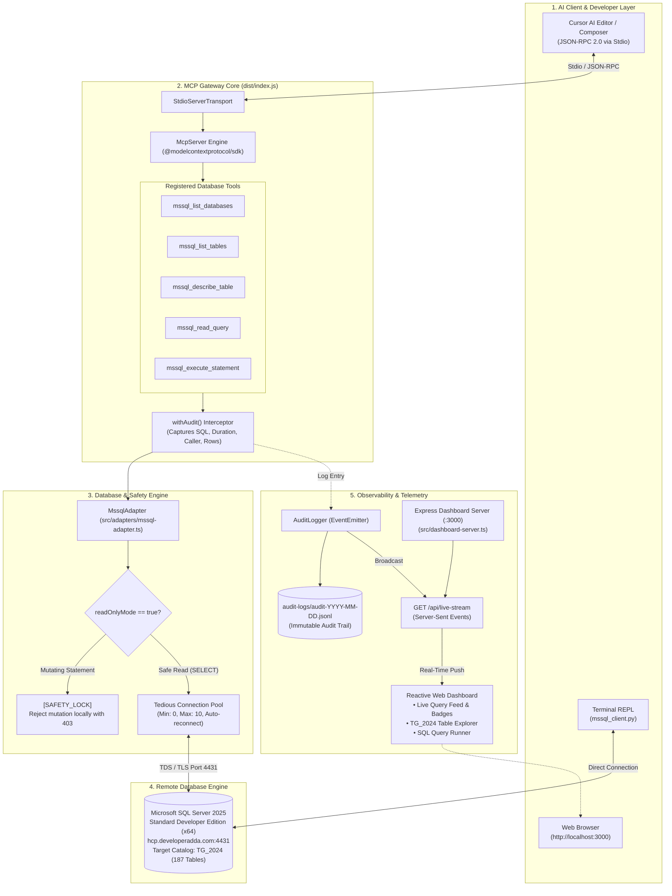
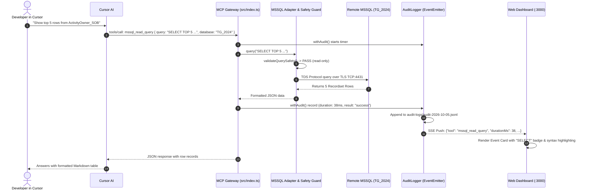

# MSSQL MCP Gateway & Live Real-Time Dashboard — Project Overview

> **A high-performance Model Context Protocol (MCP) server bridging Microsoft SQL Server 2025 (`TG_2024`) with Cursor AI, featuring real-time Server-Sent Events (SSE) telemetry, an immutable audit trail, and an active web observability dashboard.**

---

## 1. Executive Summary

This project delivers an enterprise-grade Model Context Protocol (MCP) gateway that connects AI coding assistants (specifically **Cursor AI**) directly to a remote **Microsoft SQL Server 2025 instance** (`hcp.developeradda.com:4431`, database `TG_2024`). 

The system enables AI models to autonomously inspect database schemas, discover tables, analyze column relationships, and execute read-only queries with millisecond latency. Simultaneously, all operations pass through a **dual-channel observability pipeline**:
1. **Immutable Audit Storage**: Appends structured JSON-Lines records to disk.
2. **Real-Time Stream Engine**: Broadcasts query metadata over Server-Sent Events (SSE) to an interactive, real-time web dashboard running on `http://localhost:3000`.

To protect critical production data, the entire system is fortified with a **Hard AST/Regex Safety Lock (`readOnlyMode = true`)** that halts and logs any data-modifying queries (`INSERT`, `UPDATE`, `DELETE`, `DROP`, `ALTER`, `TRUNCATE`, `MERGE`, `CREATE`) before any packet reaches the network.

---

## 2. Complete System Architecture

### 2.1 Architectural Flow Diagram



### 2.2 Sequence Diagram: Query Execution & Real-Time Telemetry



---

## 3. Implementation Plan & Execution History

The project was executed through a 5-stage roadmap managed via the GSD (Git. Ship. Done.) framework:

### Stage 1: Database Connectivity & MssqlAdapter Implementation
- **Goal**: Establish a resilient connection pool to `hcp.developeradda.com:4431` with TLS certificate bypass and auto-reconnect.
- **Deliverables**:
  - Installed `mssql` (`^12.7.2`) and `@types/mssql`.
  - Created [`src/adapters/mssql-adapter.ts`](src/adapters/mssql-adapter.ts) with singleton pool management, automatic connection recovery, parameter binding, and transaction handling.
  - Implemented initial AST safety guard.
  - Test suite [`tests/test-mssql-adapter.ts`](tests/test-mssql-adapter.ts) passed **9/9 tests** (100%).

### Stage 2: MCP Server Tools Integration
- **Goal**: Expose standard, type-safe MCP tools so Cursor can autonomously inspect and query the database.
- **Deliverables**:
  - Registered 5 tools in [`src/index.ts`](src/index.ts) using Zod schema validation:
    1. `mssql_list_databases`
    2. `mssql_list_tables`
    3. `mssql_describe_table`
    4. `mssql_read_query`
    5. `mssql_execute_statement` (gated by safety lock)
  - Wrapped each tool in `withAudit()` for automatic telemetry.
  - Compiled clean binary to `dist/index.js` (0 errors).

### Stage 3: Real-Time Event Streaming & Audit Layer
- **Goal**: Stream database operations in real-time to external observers without polling.
- **Deliverables**:
  - Augmented [`src/middleware/audit-logger.ts`](src/middleware/audit-logger.ts) with a Node `EventEmitter`.
  - Added Server-Sent Events (SSE) route `GET /api/live-stream` in [`src/dashboard-server.ts`](src/dashboard-server.ts) with 15-second heartbeat keep-alives.
  - Verified concurrent client broadcast.

### Stage 4: Live Dashboard UI for AI Changes
- **Goal**: Interactive web dashboard at `http://localhost:3000` to visually inspect changes made by Cursor.
- **Deliverables**:
  - Built modern single-page dashboard ([`dashboard/index.html`](dashboard/index.html), [`dashboard/app.js`](dashboard/app.js), [`dashboard/style.css`](dashboard/style.css)).
  - **Live Query Monitor**: Real-time event cards with color-coded operation badges (`SELECT`, `INSERT`, `UPDATE`, `DELETE`, `BLOCKED`), execution duration, and full SQL syntax highlighting with copy buttons.
  - **TG_2024 Table Explorer**: Instant searchable table browser inspecting all 187 tables with one-click data previews.
  - **SQL Query Runner**: Safe browser-based read-only SQL editor.
  - Automated test suite [`tests/test-dashboard-server.ts`](tests/test-dashboard-server.ts) passed **7/7 tests** (100%).

### Stage 5: Cursor MCP Integration & End-to-End Verification
- **Goal**: Configure Cursor AI editor and verify the complete stack with an end-to-end simulated client.
- **Deliverables**:
  - Configured `~/.cursor/mcp.json` with stdio transport and environment variables.
  - Built automated stdio client simulator [`tests/test-cursor-mcp-e2e.ts`](tests/test-cursor-mcp-e2e.ts) passing **8/8 tests** (100%).
  - Cleaned and isolated workspace: moved legacy SAP/BTP mock files to [`archive_legacy_sap_system/`](archive_legacy_sap_system).

---

## 4. Security & Data Safety Protocol

Because the target database (`TG_2024`) contains vital live data, the gateway implements a **Strict Read-Only Mandate**:

```
Input Query
   │
   ▼
[AST & Regex Mutation Classifier]
   ├── Matches: INSERT | UPDATE | DELETE | DROP | ALTER | TRUNCATE | MERGE | CREATE | GRANT | REVOKE
   │      │
   │      ▼
   │   readOnlyMode == true?
   │      ├── YES ──► [HALT & REJECT] ──► Return [SAFETY_LOCK] error (0 network packets sent)
   │      └── NO  ──► Forward to Database Connection Pool
   │
   └── Matches: SELECT | EXEC (read) | INFORMATION_SCHEMA
          │
          ▼
       [FORWARD] ──► Execute via TDS Protocol on TCP 4431
```

* **Default Configuration**: `readOnlyMode: true` is hardcoded as default and verified across all entrypoints.
* **Pre-Transmission Interception**: Mutations are caught at the application boundary; no write packet ever reaches the database.
* **Future-Proof Write Engine**: The complete execution engine (including transaction handling with `begin`, `commit`, and `rollback`) is fully implemented in `MssqlAdapter` and can be unlocked when write permissions are explicitly granted.

---

## 5. MCP Tools Reference

| Tool Name | Parameters | Purpose | Safety Rule |
|---|---|---|:---:|
| `mssql_list_databases` | `{}` | Lists all online databases (`TG_2024`, `master`, `tempdb`, `model`, `msdb`). | Allowed |
| `mssql_list_tables` | `database?: string` | Lists all 187 tables and views with schema names and row counts. | Allowed |
| `mssql_describe_table` | `table: string, schema?: string, database?: string` | Returns column definitions, data types, nullability, and primary key flags. | Allowed |
| `mssql_read_query` | `query: string, params?: object, database?: string, limit?: number` | Executes read-only queries with optional parameter bindings and row caps. | Allowed |
| `mssql_execute_statement` | `query: string, params?: object, database?: string` | Executes mutating statements (`INSERT`, `UPDATE`, etc.). | **BLOCKED** by Safety Lock |

---

## 6. Verification & Test Matrix

All 24 automated tests pass with a 100% success rate:

```text
======================================================================
  AUTOMATED VERIFICATION SUMMARY
======================================================================
  [1] tests/test-mssql-adapter.ts       9 / 9  PASS (100%)
  [2] tests/test-dashboard-server.ts    7 / 7  PASS (100%)
  [3] tests/test-cursor-mcp-e2e.ts      8 / 8  PASS (100%)
----------------------------------------------------------------------
  Total Automated Tests:               24 / 24 PASS (100%)
======================================================================
```

---

## 7. Directory Layout & File Manifest

```text
MCP System/
├── .planning/                        # GSD Governance & Planning artifacts
│   ├── PROJECT.md                    # Core project definition
│   ├── REQUIREMENTS.md               # Functional & non-functional specifications
│   ├── ROADMAP.md                    # Phased execution milestones
│   ├── STATE.md                      # Real-time state & decision records
│   ├── SESSION_HANDOVER.md           # Reboot & continuity handover
│   └── config.json                   # GSD configuration
├── archive_legacy_sap_system/        # Archived legacy SAP/BTP mock files & adapters
├── audit-logs/                       # Daily JSONL logs of real database queries
├── dashboard/                        # Web Dashboard frontend assets
│   ├── index.html                    # Single-page UI with topbar and tab routing
│   ├── app.js                        # SSE listener, syntax highlighter, table explorer
│   └── style.css                     # Responsive dark-theme styling
├── dist/                             # Compiled production JavaScript files
├── src/                              # Active TypeScript source code
│   ├── adapters/
│   │   └── mssql-adapter.ts          # Core MSSQL connection pool & safety guard
│   ├── middleware/
│   │   └── audit-logger.ts           # Event emitter & JSONL audit writer
│   ├── index.ts                      # MCP Server stdio entrypoint (5 tools)
│   └── dashboard-server.ts           # Express SSE server on port 3000
├── tests/                            # Automated QA verification suites
│   ├── test-mssql-adapter.ts         # Database adapter tests (9/9 PASS)
│   ├── test-dashboard-server.ts      # REST & SSE stream tests (7/7 PASS)
│   └── test-cursor-mcp-e2e.ts        # Cursor AI stdio protocol simulation (8/8 PASS)
├── PROJECT_OVERVIEW.md               # Master architecture & overview documentation
├── README_MSSQL_MCP.md               # User manual & Cursor prompt examples
├── SESSION_SUMMARY.md                # Quick root summary
└── package.json                      # Project dependencies and npm scripts
```

---

## 8. Quick Start & Operation

### 8.1 Start the Live Dashboard
```bash
cd "/run/media/promethious/Personal/Projects/MCP System"
npm run dashboard
```
Open **[http://localhost:3000](http://localhost:3000)** in your browser.

### 8.2 Cursor AI Integration
Cursor is pre-configured in `~/.cursor/mcp.json`. When Cursor opens:
1. The MCP Gateway launches automatically via stdio transport.
2. Ask Cursor in natural language:
   > *"List all tables in TG_2024 related to SOB."*  
   > *"Describe the schema of ActivityOwner_SOB."*  
   > *"Query the top 5 records from ActivityOwner_SOB for Customer_Code 'BAJAJ'."*
3. Watch the queries appear live on the dashboard at `http://localhost:3000`.

### 8.3 Run Automated Tests
```bash
npx tsx tests/test-cursor-mcp-e2e.ts
```
